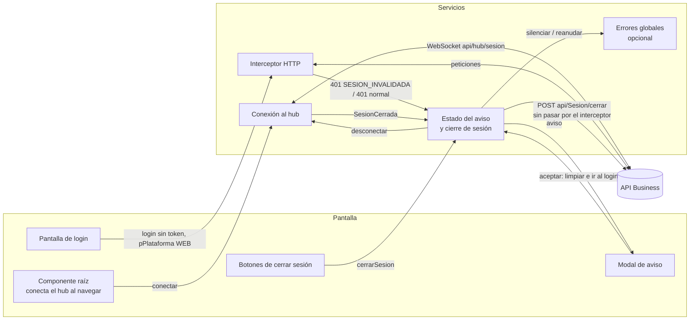
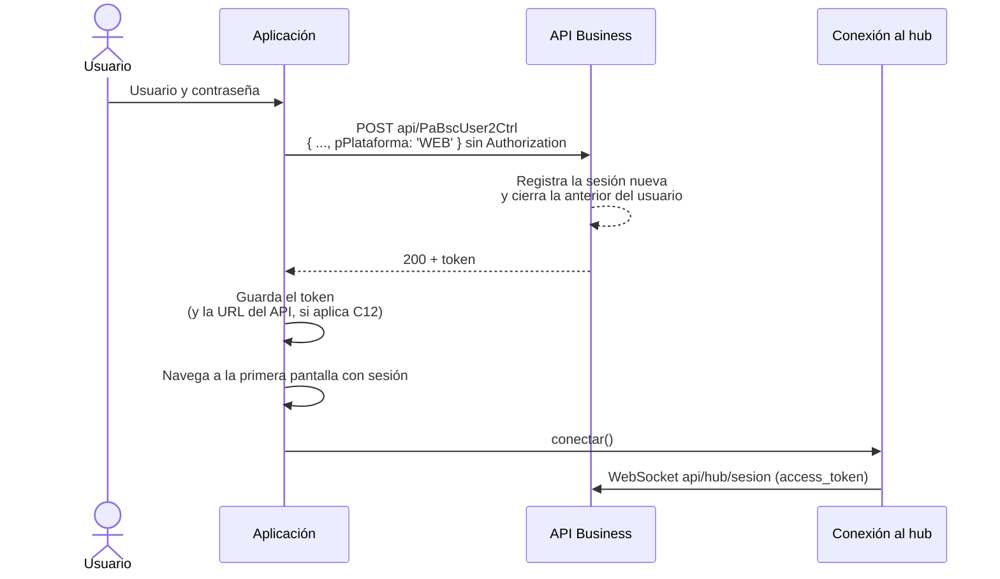
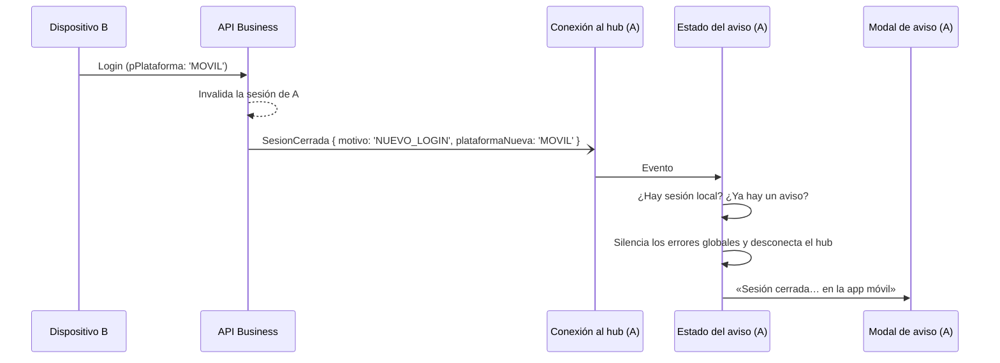
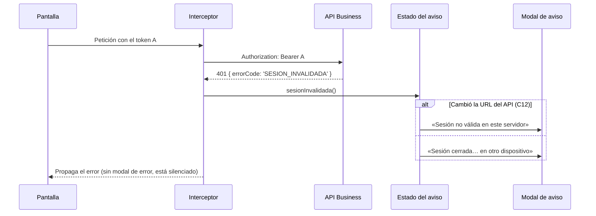
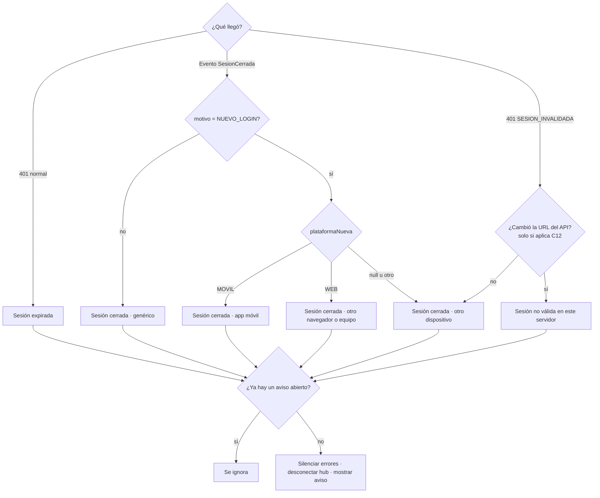
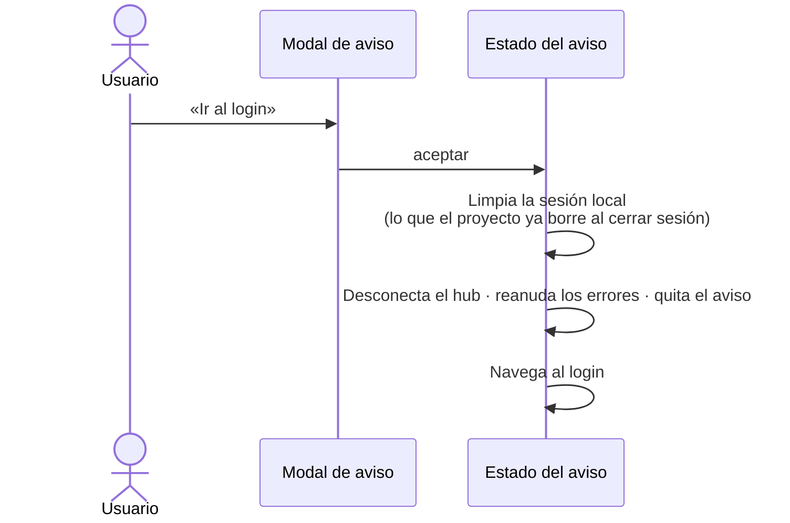
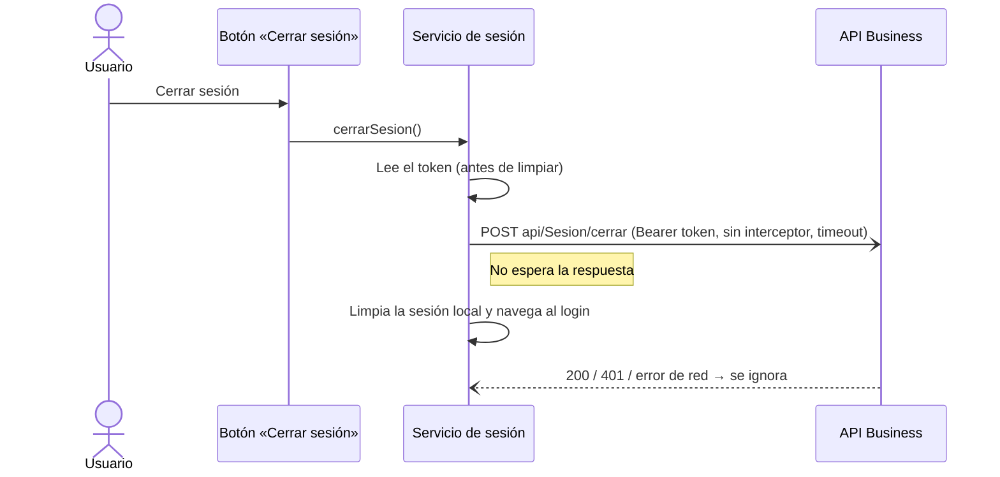
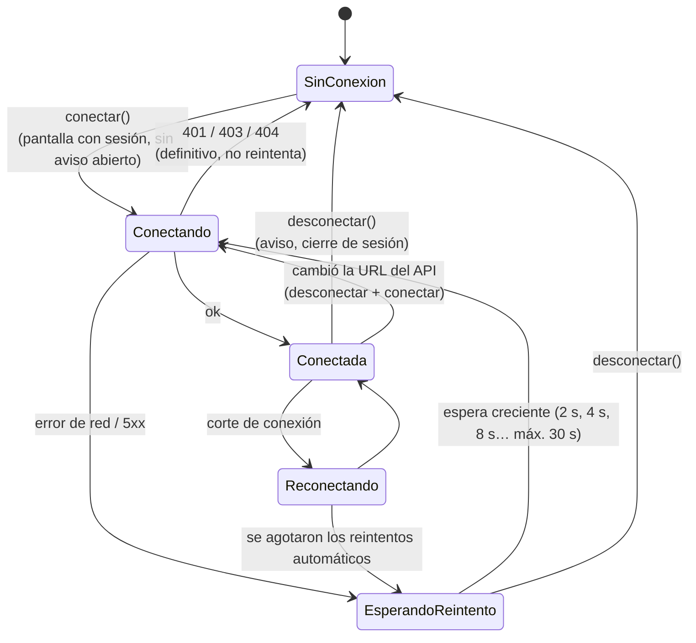

# Estándar de sesión única: guía de implementación en Angular

Esta guía explica cómo implementar la **sesión única** en una aplicación Angular que consume el API Business: un usuario puede tener una sola sesión activa entre todas las plataformas (portal web y app móvil).

Está escrita para que la siga **cualquier equipo**, tenga la estructura que tenga.

- **El estándar** son el contrato con el API (sección 2) y los comportamientos obligatorios (sección 3). Eso tiene que cumplirse igual en todas las implementaciones.
- **El código** de la sección 5 es una **sugerencia**. Los nombres de servicios, componentes y archivos son ejemplos: adáptalos a lo que ya tenga tu proyecto. Si ya tienes un interceptor, un servicio de sesión o un modal global, agrega ahí lo que corresponda en vez de crear piezas nuevas.

| Referencia | |
|---|---|
| **Versión** | 1.0.0 — 2026-10-30 |
| Colección de pruebas del API | `ApiBusiness_Sesion_Unica.postman_collection.json`, en `business/docs/SCRIPTS_API/` del repositorio del portal GD02 (no está en este repositorio) |
| Dependencia | `@microsoft/signalr` (el código de ejemplo se probó con la `10.x`) |
| Versión de Angular de los ejemplos | 15 o superior (`inject()`, interceptores funcionales, componentes standalone). La sección 5.9 explica las equivalencias para versiones anteriores. |
| Implementación de referencia | Portal web GD02, commit `eb233c0` (ver el [Anexo](#anexo-implementación-de-referencia-portal-gd02)) |

---

## Índice

1. [Qué es y qué resuelve](#1-qué-es-y-qué-resuelve)
2. [Contrato con el API](#2-contrato-con-el-api)
3. [Comportamientos obligatorios](#3-comportamientos-obligatorios)
4. [Responsabilidades y flujos](#4-responsabilidades-y-flujos)
5. [Implementación sugerida](#5-implementación-sugerida)
6. [Textos del aviso](#6-textos-del-aviso)
7. [Lista de verificación](#7-lista-de-verificación)
8. [Pruebas](#8-pruebas)
9. [Compatibilidad con un API sin sesión única](#9-compatibilidad-con-un-api-sin-sesión-única)
10. [Preguntas frecuentes](#10-preguntas-frecuentes)
11. [Anexo: implementación de referencia (portal GD02)](#anexo-implementación-de-referencia-portal-gd02)
12. [Historial](#historial)

---

## 1. Qué es y qué resuelve

| Sin sesión única | Con sesión única |
|---|---|
| El mismo usuario puede estar abierto en varios navegadores y en la app al mismo tiempo. | Cada login nuevo cierra la sesión anterior del usuario, en cualquier plataforma. |
| El token deja de servir solo cuando vence. | El token deja de servir en cuanto su sesión se reemplaza o se cierra. |
| «Cerrar sesión» solo borra los datos locales; el token sigue siendo válido en el servidor. | «Cerrar sesión» avisa al API, que invalida el token. |

El usuario cuya sesión se reemplazó se entera de dos maneras:

1. **Al instante:** el API le envía un evento por SignalR y la aplicación muestra un aviso con el motivo.
2. **En la siguiente petición:** si el evento no llegó (sin conexión al hub, pestaña suspendida, red bloqueada), el API responde `401` con `errorCode: "SESION_INVALIDADA"` y la aplicación muestra el mismo aviso.

**Quien protege la sesión es el API.** El hub solo adelanta el aviso: si no conecta, el `401` garantiza que el token ya no sirva.

---

## 2. Contrato con el API

En los ejemplos, `{baseUrl}` es la URL base del API, la misma variable `baseUrl` de la colección Postman. Cada proyecto la arma a su manera; en el portal GD02, por ejemplo, termina en `GD02/Apis`.

### 2.1 Login: `POST {baseUrl}/api/PaBscUser2Ctrl`

El login de siempre, con un campo nuevo, `pPlataforma`:

```json
{
  "pOpcion": 1,
  "pUserName": "usuario",
  "pPass": "********",
  "pPlataforma": "WEB"
}
```

| `pPlataforma` | Quién lo envía |
|---|---|
| `"WEB"` | Aplicaciones web (Angular) |
| `"MOVIL"` | App móvil (Flutter) |

- El API registra la sesión nueva, cierra la anterior del mismo usuario y avisa a esa sesión por el hub.
- El token que devuelve queda ligado a la sesión nueva.
- **El login no debe llevar el header `Authorization`.** Si la aplicación guarda un token anterior, puede ser de una sesión que el API ya cerró.

> `pDispositivo` aparece en la colección Postman, pero **el backend lo descartó**. No lo envíes.

### 2.2 Cerrar sesión: `POST {baseUrl}/api/Sesion/cerrar`

| Dato | Valor |
|---|---|
| Body | Ninguno. La sesión se identifica por el token. |
| Header | `Authorization: Bearer <token>` |
| `200` | Sesión cerrada; el token deja de servir. |
| `401` | El token ya no era válido (sesión ya cerrada o vencida). Se ignora. |

### 2.3 Sesión reemplazada: `401` con `SESION_INVALIDADA`

Cualquier endpoint protegido responde así cuando el token pertenece a una sesión que ya no es la vigente:

```json
{
  "status": 401,
  "message": "...",
  "errorCode": "SESION_INVALIDADA"
}
```

Un `401` **sin** ese `errorCode` significa lo de siempre: token vencido, inválido o ausente.

### 2.4 Hub de sesión (SignalR): `{baseUrl}/api/hub/sesion`

| Dato | Valor |
|---|---|
| Autenticación | El token. Con el cliente de SignalR se pasa con `accessTokenFactory`; SignalR lo envía como `?access_token=` en el WebSocket. |
| Métodos a invocar | Ninguno. El servidor une la conexión al grupo de su sesión. |
| Evento a escuchar | `SesionCerrada` |

Payload de `SesionCerrada`:

```json
{ "motivo": "NUEVO_LOGIN", "plataformaNueva": "MOVIL" }
```

| Campo | Valores |
|---|---|
| `motivo` | Hoy solo `NUEVO_LOGIN`. Cualquier otro valor se trata como un cierre genérico. |
| `plataformaNueva` | `WEB`, `MOVIL` o `null`: el `pPlataforma` del login que causó el cierre. |

Si la aplicación ya usa otro hub de SignalR (por ejemplo, el de Colas, que es anónimo), **este es una conexión aparte**: no se reutiliza.

---

## 3. Comportamientos obligatorios

Estos comportamientos definen el estándar. Cómo se implementen depende de cada proyecto.

| # | Comportamiento | Detalle |
|---|---|---|
| C1 | **Login con `pPlataforma: 'WEB'`** | Sin el header `Authorization`, aunque haya un token guardado. |
| C2 | **Escuchar `SesionCerrada` mientras haya sesión** | Conectar al hub al entrar con sesión (después del login, al recargar, en cada pestaña) y desconectar al salir. No conectar en pantallas sin sesión (login, páginas públicas). |
| C3 | **Distinguir los dos `401`** | `SESION_INVALIDADA`: aviso de «sesión cerrada». Cualquier otro `401`: el aviso de sesión expirada que ya tenga la aplicación. |
| C4 | **Un solo aviso** | El evento del hub y los `401` de las peticiones en paralelo llegan casi juntos. Se muestra el primero y se ignoran los demás hasta que el usuario lo acepte. |
| C5 | **El aviso bloquea la pantalla** | Modal sin opción de cerrarlo y seguir trabajando. Su único botón lleva al login. Debe quedar **por encima** de cualquier overlay de carga o notificación. |
| C6 | **No apilar errores sobre el aviso** | Con el aviso abierto, los errores de las peticiones que siguen fallando no deben abrir sus propios modales encima. |
| C7 | **Mensaje según el motivo** | Ver la [sección 6](#6-textos-del-aviso). Mínimo: distinguir «app móvil», «otro navegador» y «otro dispositivo». |
| C8 | **Limpiar la sesión al aceptar el aviso, no al recibirlo** | Así cada pestaña abierta con la misma sesión muestra su propio aviso con el motivo correcto. Si una pestaña borra el storage antes, las demás ven un `401` sin token y dicen «sesión expirada». |
| C9 | **Cerrar sesión avisa al API** | `POST api/Sesion/cerrar` con el token, **sin esperar la respuesta**: la sesión local se cierra aunque la petición falle. Todos los botones de cerrar sesión deben pasar por aquí. |
| C10 | **El `401` del cierre de sesión no abre el aviso** | Si la sesión ya estaba cerrada, el API responde `401`; no debe aparecer el modal justo después de salir. |
| C11 | **El hub no reintenta errores definitivos** | Con `401`/`403` (el token ya no sirve) o `404` (el API no tiene el hub) se deja de intentar. Con errores de red sí se reintenta, con espera creciente. |
| C12 | *(Solo si la aplicación permite cambiar la URL del API sin cerrar sesión)* **Mensaje de servidor distinto** | El token de un servidor no existe en otro, y el `401` diría «otro dispositivo», que es falso. Hay que guardar la URL con la que se inició sesión y, si ya no coincide, mostrar «Sesión no válida en este servidor». |
| C13 | **Kioscos y pantallas públicas con usuario propio** | No se programa ninguna excepción. Si un kiosco y un operador comparten usuario, uno cierra la sesión del otro. |

---

## 4. Responsabilidades y flujos

### 4.1 Responsabilidades

La implementación se reparte en estas responsabilidades. Pueden vivir en piezas nuevas o en las que ya tenga el proyecto: la columna «Dónde suele ir» es solo orientativa.

| Responsabilidad | Qué hace | Dónde suele ir |
|---|---|---|
| **Conexión al hub** | Abre y cierra la conexión, reintenta y publica el evento `SesionCerrada`. No decide qué mostrar. | Un servicio propio (sugerido: `SesionHubService`) |
| **Estado del aviso** | Decide si hay que mostrar un aviso y cuál. Garantiza que sea uno solo. | El servicio que ya maneje la sesión, o uno nuevo (sugerido: `SesionUnicaService`) |
| **Cierre de sesión** | Avisa al API y limpia la sesión local. | El mismo servicio de sesión |
| **Detección del `401`** | Distingue `SESION_INVALIDADA` de un `401` normal y notifica al estado del aviso. | El interceptor HTTP que ya adjunte el token |
| **Login sin token** | Evita que el login lleve `Authorization`. | El interceptor (con una marca en la petición) o la llamada del login |
| **Aviso en pantalla** | Muestra el modal con título y mensaje, y lleva al login. | El modal global que ya tenga la aplicación, o uno nuevo |
| **Conexión al navegar** | Conecta el hub cuando se entra a una pantalla con sesión. | El componente raíz o un guard |
| **Silenciar errores** | Evita que otros modales de error tapen el aviso (C6). | El servicio global de errores, si existe |

### 4.2 Relación entre las responsabilidades



**Sugerencia para evitar dependencias circulares:** el servicio de estado depende de la conexión al hub, nunca al revés. El hub solo publica el evento; el estado se suscribe. Del mismo modo, si el interceptor usa el servicio de estado y el login usa una marca que lee el interceptor, conviene poner esa marca en su propio archivo (ver 5.2).

### 4.3 Login



### 4.4 Otro dispositivo inicia sesión: aviso al instante



### 4.5 Otro dispositivo inicia sesión: aviso en la siguiente petición



### 4.6 Elección del mensaje



El `401` no dice desde qué plataforma se inició la sesión nueva; por eso, en ese camino, el mensaje es el genérico de «otro dispositivo».

### 4.7 Aceptar el aviso



### 4.8 Cerrar sesión



### 4.9 Ciclo de vida de la conexión al hub



---

## 5. Implementación sugerida

> Todo el código de esta sección es **una propuesta**. Los nombres (`SesionHubService`, `SesionUnicaService`, `SIN_TOKEN`, `ModalSesionComponent`…), las rutas de archivo y la forma de inyectar la configuración son ejemplos. Lo que importa es cumplir los comportamientos de la sección 3.
>
> Los puntos que dependen del proyecto están marcados con `// ADAPTAR`.

### 5.1 Configuración: lo que cada proyecto aporta

Para no asumir cómo guarda cada proyecto la URL del API, el token o los datos de sesión, los ejemplos reciben esos datos en un objeto de configuración. Es una forma de conectar el código sugerido con lo que ya existe. Si lo prefieres, puedes llamar directamente a tus servicios.

```ts
// sesion-unica.config.ts
import { InjectionToken } from '@angular/core';

export interface SesionUnicaConfig {
  /** URL base del API (la `baseUrl` de la colección Postman), sin `/` final. */
  obtenerBaseUrl: () => string;
  /** Token de la sesión actual, o null si no hay. */
  obtenerToken: () => string | null;
  /** true si hay una sesión iniciada en este navegador. */
  haySesion: () => boolean;
  /** Borra lo que el proyecto ya borre al cerrar sesión (storage, cachés, estado). */
  limpiarSesionLocal: () => void;
  /** Ruta de la pantalla de login. */
  rutaLogin: string;
  /**
   * Opcional (C12): URL del API con la que se inició la sesión. Solo si la aplicación
   * permite cambiar de servidor sin cerrar sesión.
   */
  obtenerBaseUrlDeLaSesion?: () => string | null;
}

export const SESION_UNICA_CONFIG = new InjectionToken<SesionUnicaConfig>(
  'SESION_UNICA_CONFIG',
);
```

Ejemplo de registro, en `app.config.ts`, `main.ts` o el módulo raíz:

```ts
import { SESION_UNICA_CONFIG } from './sesion-unica/sesion-unica.config';

providers: [
  {
    provide: SESION_UNICA_CONFIG,
    useValue: {
      // ADAPTAR: de dónde sale cada dato en tu proyecto
      obtenerBaseUrl: () => environment.apiUrl,
      obtenerToken: () => localStorage.getItem('token'),
      haySesion: () => !!localStorage.getItem('token'),
      limpiarSesionLocal: () => { localStorage.clear(); sessionStorage.clear(); },
      rutaLogin: '/login',
    },
  },
],
```

Si `limpiarSesionLocal` o `haySesion` necesitan otros servicios, usa `useFactory` con `deps`, o `inject()` dentro de la factory.

### 5.2 Marca de «petición sin token»

Necesaria para C1 si el interceptor adjunta el token a todas las peticiones. Va en su propio archivo para que el login la importe sin importar el interceptor.

```ts
// sin-token.context.ts
import { HttpContextToken } from '@angular/common/http';

/**
 * Pide al interceptor que no adjunte el token guardado. Uso:
 * `{ context: new HttpContext().set(SIN_TOKEN, true) }`.
 */
export const SIN_TOKEN = new HttpContextToken<boolean>(() => false);
```

Si tu proyecto ya tiene otra forma de excluir peticiones del interceptor (una lista de URLs, un header especial), úsala.

### 5.3 Conexión al hub

```ts
// sesion-hub.service.ts
import { Inject, Injectable } from '@angular/core';
import { Subject } from 'rxjs';
import * as signalR from '@microsoft/signalr';
import { SESION_UNICA_CONFIG, SesionUnicaConfig } from './sesion-unica.config';

/** Payload del evento `SesionCerrada`. */
export interface SesionCerradaEvento {
  /** Hoy solo `NUEVO_LOGIN`; cualquier otro valor se trata como un cierre genérico. */
  motivo: string;
  plataformaNueva: 'WEB' | 'MOVIL' | null;
}

/**
 * Conexión al hub `api/hub/sesion`. Solo publica el evento: qué mostrar lo decide quien
 * se suscribe a `sesionCerrada$`. Este servicio no depende de ese otro (evita ciclos).
 */
@Injectable({ providedIn: 'root' })
export class SesionHubService {
  private connection: signalR.HubConnection | null = null;
  private retryTimer: ReturnType<typeof setTimeout> | null = null;
  private intentosReintento = 0;

  readonly sesionCerrada$ = new Subject<SesionCerradaEvento>();

  constructor(@Inject(SESION_UNICA_CONFIG) private config: SesionUnicaConfig) {}

  /** Abre la conexión si no hay una. Se puede llamar en cada navegación. */
  conectar(): void {
    if (this.connection) return;

    const baseUrl = this.config.obtenerBaseUrl();
    if (!baseUrl || !this.config.obtenerToken()) return;

    const conn = new signalR.HubConnectionBuilder()
      .withUrl(`${baseUrl}/api/hub/sesion`, {
        // Se lee en cada negociación: una reconexión usa siempre el token vigente
        accessTokenFactory: () => this.config.obtenerToken() || '',
      })
      .withAutomaticReconnect([0, 2000, 5000, 10000, 30000])
      .configureLogging(signalR.LogLevel.Warning)
      .build();

    this.connection = conn;
    // Los callbacks de una conexión ya descartada se ignoran
    const esActual = () => conn === this.connection;

    conn.on('SesionCerrada', (evento: SesionCerradaEvento | null) => {
      if (!esActual()) return;
      this.sesionCerrada$.next({
        motivo: evento?.motivo ?? '',
        plataformaNueva: evento?.plataformaNueva ?? null,
      });
    });

    // La reconexión automática se rindió: se vuelve a empezar con espera creciente
    conn.onclose(() => {
      if (esActual()) this.programarReintento();
    });

    this.iniciar(conn);
  }

  /** Cierra la conexión y cancela los reintentos. */
  desconectar(): void {
    if (this.retryTimer) {
      clearTimeout(this.retryTimer);
      this.retryTimer = null;
    }
    this.intentosReintento = 0;
    const conn = this.connection;
    this.connection = null;
    conn?.stop().catch(() => undefined);
  }

  /** Si la URL del API puede cambiar con la sesión abierta, llamar esto al cambiarla. */
  reconectar(): void {
    if (!this.connection) return;
    this.desconectar();
    this.conectar();
  }

  private iniciar(conn: signalR.HubConnection): void {
    conn
      .start()
      .then(() => {
        if (conn === this.connection) this.intentosReintento = 0;
      })
      .catch((err) => {
        if (conn !== this.connection) return;
        if (SesionHubService.esErrorDefinitivo(err)) {
          // C11: el token ya no sirve o el API no tiene el hub
          console.warn('Hub de sesión: no se reintenta la conexión', err);
          this.desconectar();
          return;
        }
        console.warn('Hub de sesión: error al conectar, se reintentará', err);
        this.programarReintento();
      });
  }

  private programarReintento(): void {
    if (!this.connection || this.retryTimer) return;
    const espera = Math.min(30000, 2000 * 2 ** this.intentosReintento);
    this.intentosReintento++;
    this.retryTimer = setTimeout(() => {
      this.retryTimer = null;
      const conn = this.connection;
      if (conn?.state === signalR.HubConnectionState.Disconnected) {
        this.iniciar(conn);
      }
    }, espera);
  }

  /**
   * 401/403: el token ya no sirve. 404: el API no tiene el hub. Cuando falla la negociación,
   * el código no siempre viene como propiedad, sino en el mensaje (`Status code '401'`).
   */
  private static esErrorDefinitivo(err: unknown): boolean {
    const codigo = (err as { statusCode?: number } | null)?.statusCode;
    if (codigo === 401 || codigo === 403 || codigo === 404) return true;
    return /Status code '(401|403|404)'/.test(String(err));
  }
}
```

### 5.4 Estado del aviso y cierre de sesión

Si tu proyecto ya tiene un servicio de sesión, lo más simple es agregarle estos miembros en vez de crear otro.

```ts
// sesion-unica.service.ts
import { Inject, Injectable } from '@angular/core';
import { HttpBackend, HttpClient, HttpHeaders } from '@angular/common/http';
import { Router } from '@angular/router';
import { BehaviorSubject, Subject, timeout } from 'rxjs';
import { SESION_UNICA_CONFIG, SesionUnicaConfig } from './sesion-unica.config';
import { SesionCerradaEvento, SesionHubService } from './sesion-hub.service';

/** Título y mensaje del aviso (claves de traducción o textos, según el proyecto). */
export interface AvisoSesion {
  titulo: string;
  mensaje: string;
}

@Injectable({ providedIn: 'root' })
export class SesionUnicaService {
  static readonly ERROR_SESION_INVALIDADA = 'SESION_INVALIDADA';

  /** Aviso a mostrar; null = sin aviso. Solo el primero cuenta (C4). */
  private avisoSubject = new BehaviorSubject<AvisoSesion | null>(null);
  readonly aviso$ = this.avisoSubject.asObservable();

  /**
   * Opcional (C6): emite true al abrirse el aviso y false al limpiarse. Útil para que el
   * servicio global de errores deje de mostrar modales mientras tanto.
   */
  readonly silenciarErrores$ = new Subject<boolean>();

  // C10: el cierre de sesión no pasa por los interceptores
  private httpSinInterceptores: HttpClient;

  constructor(
    @Inject(SESION_UNICA_CONFIG) private config: SesionUnicaConfig,
    private hub: SesionHubService,
    private router: Router,
    httpBackend: HttpBackend,
  ) {
    this.httpSinInterceptores = new HttpClient(httpBackend);
    this.hub.sesionCerrada$.subscribe((evento) => this.sesionInvalidada(evento));
  }

  /** true mientras el aviso está abierto. */
  get sesionTerminada(): boolean {
    return this.avisoSubject.value !== null;
  }

  /** 401 sin `SESION_INVALIDADA`. ADAPTAR: si ya tienes un aviso de sesión expirada, usa ese. */
  sesionExpirada(): void {
    this.mostrarAviso({
      titulo: 'sesion.expirada',
      mensaje: 'sesion.expiradaMsg',
    });
  }

  /**
   * La sesión ya no es la vigente: por el evento del hub (con `evento`) o por un 401
   * `SESION_INVALIDADA` (sin `evento`). No limpia nada todavía (C8).
   */
  sesionInvalidada(evento?: SesionCerradaEvento): void {
    if (!this.config.haySesion()) return;
    this.mostrarAviso(this.elegirAviso(evento));
  }

  /** El usuario aceptó el aviso. */
  aceptarAviso(): void {
    this.limpiar();
    this.router.navigate([this.config.rutaLogin]);
  }

  /** C9: todos los botones de «Cerrar sesión» deben llamar a este método. */
  cerrarSesion(): void {
    // El token se lee antes de limpiar
    const token = this.config.obtenerToken();
    const baseUrl = this.config.obtenerBaseUrl();

    if (token && baseUrl) {
      this.httpSinInterceptores
        .post(
          `${baseUrl}/api/Sesion/cerrar`,
          {},
          { headers: new HttpHeaders().set('Authorization', `Bearer ${token}`) },
        )
        .pipe(timeout(10000))
        .subscribe({ error: () => undefined }); // No se espera ni se muestra nada
    }

    this.limpiar();
    this.router.navigate([this.config.rutaLogin]);
  }

  private limpiar(): void {
    this.config.limpiarSesionLocal();
    this.hub.desconectar();
    this.silenciarErrores$.next(false);
    this.avisoSubject.next(null);
  }

  private mostrarAviso(aviso: AvisoSesion): void {
    if (this.avisoSubject.value) return; // C4
    this.silenciarErrores$.next(true); // C6
    this.hub.desconectar();
    this.avisoSubject.next(aviso);
  }

  private elegirAviso(evento?: SesionCerradaEvento): AvisoSesion {
    const titulo = 'sesion.cerrada';

    if (evento) {
      if (evento.motivo !== 'NUEVO_LOGIN') {
        return { titulo, mensaje: 'sesion.cerradaMsg' };
      }
      if (evento.plataformaNueva === 'MOVIL') {
        return { titulo, mensaje: 'sesion.cerradaAppMovilMsg' };
      }
      if (evento.plataformaNueva === 'WEB') {
        return { titulo, mensaje: 'sesion.cerradaOtroNavegadorMsg' };
      }
      return { titulo, mensaje: 'sesion.cerradaOtroDispositivoMsg' };
    }

    // C12 (opcional): el 401 se debe a un cambio de servidor, no a otro dispositivo
    const urlSesion = this.config.obtenerBaseUrlDeLaSesion?.();
    if (urlSesion && urlSesion !== this.config.obtenerBaseUrl()) {
      return { titulo: 'sesion.otroServidor', mensaje: 'sesion.otroServidorMsg' };
    }

    return { titulo, mensaje: 'sesion.cerradaOtroDispositivoMsg' };
  }
}
```

**Sobre C6 (silenciar errores):** cómo se logra depende de cómo muestre los errores tu proyecto.

- Si hay un servicio global que abre un modal por cada error, suscríbelo a `silenciarErrores$`: con `true` descarta lo que esté en cola y no muestra los siguientes; con `false` vuelve a la normalidad.
- Si cada pantalla muestra sus propios errores, una opción es que el interceptor no propague el error (o lo propague marcado) mientras `sesionTerminada` sea `true`.
- Si el modal de aviso tiene el `z-index` más alto y ningún otro modal puede quedar encima, puede bastar con eso.

### 5.5 Interceptor HTTP

Si tu proyecto ya tiene un interceptor que adjunta el token, **agrégale las dos partes marcadas** en vez de crear otro. Ejemplo como interceptor funcional:

```ts
// auth.interceptor.ts
import { HttpErrorResponse, HttpInterceptorFn } from '@angular/common/http';
import { inject } from '@angular/core';
import { Router } from '@angular/router';
import { catchError, throwError } from 'rxjs';
import { SESION_UNICA_CONFIG } from './sesion-unica.config';
import { SesionUnicaService } from './sesion-unica.service';
import { SIN_TOKEN } from './sin-token.context';

export const authInterceptor: HttpInterceptorFn = (req, next) => {
  const config = inject(SESION_UNICA_CONFIG);
  const sesion = inject(SesionUnicaService);
  const router = inject(Router);

  // Parte 1 (C1): no adjuntar el token si la petición lo pide
  const token = config.obtenerToken();
  const peticion =
    token && !req.context.get(SIN_TOKEN)
      ? req.clone({ setHeaders: { Authorization: `Bearer ${token}` } })
      : req;

  return next(peticion).pipe(
    catchError((error: HttpErrorResponse) => {
      // Parte 2 (C3): distinguir los dos 401
      const enLogin = router.url.startsWith(config.rutaLogin);
      if (error.status === 401 && !enLogin && config.haySesion()) {
        if (error.error?.errorCode === SesionUnicaService.ERROR_SESION_INVALIDADA) {
          sesion.sesionInvalidada();
        } else {
          sesion.sesionExpirada(); // ADAPTAR: lo que tu proyecto ya haga con un 401
        }
      }
      return throwError(() => error);
    }),
  );
};
```

Registro, si el proyecto usa `provideHttpClient`:

```ts
provideHttpClient(withInterceptors([authInterceptor]))
```

### 5.6 Login

Dos cambios en la llamada que ya tenga el proyecto:

```ts
import { HttpContext } from '@angular/common/http';
import { SIN_TOKEN } from './sin-token.context';

login(usuario: string, pass: string) {
  const body = {
    pOpcion: 1,
    pUserName: usuario,
    pPass: pass,
    pPlataforma: 'WEB', // C1
  };
  return this.http.post(`${baseUrl}/api/PaBscUser2Ctrl`, body, {
    context: new HttpContext().set(SIN_TOKEN, true), // C1: sin Authorization
  });
}
```

Si aplica C12, al guardar el token guarda también la URL del API con la que se inició sesión, y bórrala junto con los demás datos de la sesión. Por ejemplo:

```ts
localStorage.setItem('baseUrlSesion', baseUrl); // ADAPTAR: storage y clave del proyecto
```

### 5.7 Conectar el hub al navegar y mostrar el aviso

En el componente raíz, o donde el proyecto reaccione a la navegación:

```ts
// app.component.ts (fragmento)
import { Component, inject } from '@angular/core';
import { AsyncPipe } from '@angular/common';
import { NavigationEnd, Router, RouterOutlet } from '@angular/router';
import { filter } from 'rxjs';
import { SESION_UNICA_CONFIG } from './sesion-unica/sesion-unica.config';
import { SesionHubService } from './sesion-unica/sesion-hub.service';
import { SesionUnicaService } from './sesion-unica/sesion-unica.service';
import { ModalSesionComponent } from './sesion-unica/modal-sesion.component';

@Component({
  selector: 'app-root',
  standalone: true,
  imports: [RouterOutlet, AsyncPipe, ModalSesionComponent],
  template: `
    @if (sesion.aviso$ | async; as aviso) {
      <app-modal-sesion
        [titulo]="aviso.titulo"
        [mensaje]="aviso.mensaje"
        (aceptar)="sesion.aceptarAviso()"
      />
    }
    <router-outlet />
  `,
})
export class AppComponent {
  readonly sesion = inject(SesionUnicaService);
  private readonly hub = inject(SesionHubService);
  private readonly config = inject(SESION_UNICA_CONFIG);

  constructor() {
    // C2: cubre la entrada tras el login, la recarga y cada pestaña.
    // conectar() no hace nada si ya hay conexión.
    inject(Router)
      .events.pipe(filter((e): e is NavigationEnd => e instanceof NavigationEnd))
      .subscribe((e) => {
        const url = e.urlAfterRedirects;
        // ADAPTAR: rutas sin sesión del proyecto (login, páginas públicas)
        const sinSesion = url.startsWith(this.config.rutaLogin);
        if (!sinSesion && !this.sesion.sesionTerminada && this.config.haySesion()) {
          this.hub.conectar();
        }
      });
  }
}
```

Con Angular anterior a la 17, usa `*ngIf="sesion.aviso$ | async as aviso"` en lugar de `@if`.

### 5.8 Modal del aviso

Si el proyecto ya tiene un modal global de «sesión expirada», basta con que acepte título y mensaje variables. Si no, un ejemplo mínimo:

```ts
// modal-sesion.component.ts
import { Component, EventEmitter, Input, Output } from '@angular/core';
import { TranslatePipe } from '@ngx-translate/core'; // ADAPTAR: o el sistema de i18n del proyecto

@Component({
  selector: 'app-modal-sesion',
  standalone: true,
  imports: [TranslatePipe],
  template: `
    <div class="fondo" role="alertdialog" aria-modal="true" aria-labelledby="sesion-titulo">
      <div class="caja">
        <h3 id="sesion-titulo">{{ titulo | translate }}</h3>
        <p>{{ mensaje | translate }}</p>
        <button type="button" (click)="aceptar.emit()">{{ 'sesion.irAlLogin' | translate }}</button>
      </div>
    </div>
  `,
  styles: [`
    .fondo {
      position: fixed;
      inset: 0;
      display: flex;
      align-items: center;
      justify-content: center;
      background: rgba(0, 0, 0, 0.7);
      /* C5: por encima de cualquier overlay de carga o notificación del proyecto */
      z-index: 10000;
    }
    .caja {
      max-width: 450px;
      width: 90%;
      padding: 30px;
      border-radius: 12px;
      background: #fff;
      text-align: center;
    }
  `],
})
export class ModalSesionComponent {
  @Input({ required: true }) titulo!: string;
  @Input({ required: true }) mensaje!: string;
  @Output() aceptar = new EventEmitter<void>();
}
```

Lo que debe cumplir, lo implementes como lo implementes:

- **Sin botón de cerrar ni cierre al hacer clic afuera**: la única salida es ir al login (C5).
- El **`z-index`** más alto de la aplicación. Revisa los de tus overlays de carga y notificaciones.
- Los colores y estilos, los del sistema de diseño del proyecto.

### 5.9 Equivalencias para Angular anterior a la 15

| En los ejemplos | Alternativa |
|---|---|
| `HttpInterceptorFn` + `withInterceptors` | Clase que implementa `HttpInterceptor`, registrada con `{ provide: HTTP_INTERCEPTORS, useClass: ..., multi: true }`. Usa el mismo cuerpo dentro de `intercept()`. |
| `inject()` en funciones | Inyección por constructor. |
| Componentes `standalone` | Declararlos en un `NgModule`. |
| `@if` | `*ngIf`. |
| `HttpContextToken` (Angular 12+) | Un header propio (`X-Sin-Token`) que el interceptor detecta y quita antes de enviar. |

---

## 6. Textos del aviso

Textos recomendados para que el portal y la app móvil digan lo mismo. Los nombres de clave son sugeridos; usa el esquema de i18n del proyecto.

| Caso | Título | Mensaje |
|---|---|---|
| `401` normal | Sesión expirada | Tu sesión ha expirado. Por favor, inicia sesión nuevamente para continuar. |
| Evento con motivo desconocido | Sesión cerrada | Tu sesión se cerró. Inicia sesión nuevamente para continuar. |
| `NUEVO_LOGIN` desde `MOVIL` | Sesión cerrada | Tu sesión se cerró porque se inició sesión con tu usuario en la app móvil. Inicia sesión nuevamente para continuar. |
| `NUEVO_LOGIN` desde `WEB` | Sesión cerrada | Tu sesión se cerró porque se inició sesión con tu usuario en otro navegador o equipo. Inicia sesión nuevamente para continuar. |
| `NUEVO_LOGIN` sin plataforma, o `401 SESION_INVALIDADA` | Sesión cerrada | Tu sesión se cerró porque se inició sesión con tu usuario en otro dispositivo. Inicia sesión nuevamente para continuar. |
| Cambio de servidor (C12) | Sesión no válida en este servidor | Cambiaste el servidor de la API y tu sesión se inició en otro. Inicia sesión nuevamente en este servidor para continuar. |
| Botón | Ir al login | |

<details>
<summary>Ejemplo en JSON (es / en / de / fr) con las claves sugeridas</summary>

```json
{
  "sesion": {
    "expirada": "Sesión expirada",
    "expiradaMsg": "Tu sesión ha expirado. Por favor, inicia sesión nuevamente para continuar.",
    "cerrada": "Sesión cerrada",
    "cerradaMsg": "Tu sesión se cerró. Inicia sesión nuevamente para continuar.",
    "cerradaOtroDispositivoMsg": "Tu sesión se cerró porque se inició sesión con tu usuario en otro dispositivo. Inicia sesión nuevamente para continuar.",
    "cerradaAppMovilMsg": "Tu sesión se cerró porque se inició sesión con tu usuario en la app móvil. Inicia sesión nuevamente para continuar.",
    "cerradaOtroNavegadorMsg": "Tu sesión se cerró porque se inició sesión con tu usuario en otro navegador o equipo. Inicia sesión nuevamente para continuar.",
    "otroServidor": "Sesión no válida en este servidor",
    "otroServidorMsg": "Cambiaste el servidor de la API y tu sesión se inició en otro. Inicia sesión nuevamente en este servidor para continuar.",
    "irAlLogin": "Ir al login"
  }
}
```

```json
{
  "sesion": {
    "expirada": "Session expired",
    "expiradaMsg": "Your session has expired. Please sign in again to continue.",
    "cerrada": "Session closed",
    "cerradaMsg": "Your session was closed. Please sign in again to continue.",
    "cerradaOtroDispositivoMsg": "Your session was closed because your user signed in on another device. Please sign in again to continue.",
    "cerradaAppMovilMsg": "Your session was closed because your user signed in on the mobile app. Please sign in again to continue.",
    "cerradaOtroNavegadorMsg": "Your session was closed because your user signed in on another browser or computer. Please sign in again to continue.",
    "otroServidor": "Session not valid on this server",
    "otroServidorMsg": "You changed the API server and your session was started on a different one. Please sign in again on this server to continue.",
    "irAlLogin": "Go to login"
  }
}
```

```json
{
  "sesion": {
    "expirada": "Sitzung abgelaufen",
    "expiradaMsg": "Ihre Sitzung ist abgelaufen. Bitte melden Sie sich erneut an, um fortzufahren.",
    "cerrada": "Sitzung beendet",
    "cerradaMsg": "Ihre Sitzung wurde beendet. Bitte melden Sie sich erneut an, um fortzufahren.",
    "cerradaOtroDispositivoMsg": "Ihre Sitzung wurde beendet, weil sich Ihr Benutzer auf einem anderen Gerät angemeldet hat. Bitte melden Sie sich erneut an, um fortzufahren.",
    "cerradaAppMovilMsg": "Ihre Sitzung wurde beendet, weil sich Ihr Benutzer in der mobilen App angemeldet hat. Bitte melden Sie sich erneut an, um fortzufahren.",
    "cerradaOtroNavegadorMsg": "Ihre Sitzung wurde beendet, weil sich Ihr Benutzer in einem anderen Browser oder auf einem anderen Computer angemeldet hat. Bitte melden Sie sich erneut an, um fortzufahren.",
    "otroServidor": "Sitzung auf diesem Server ungültig",
    "otroServidorMsg": "Sie haben den API-Server gewechselt, und Ihre Sitzung wurde auf einem anderen Server gestartet. Bitte melden Sie sich auf diesem Server erneut an, um fortzufahren.",
    "irAlLogin": "Zur Anmeldung"
  }
}
```

```json
{
  "sesion": {
    "expirada": "Session expirée",
    "expiradaMsg": "Votre session a expiré. Veuillez vous reconnecter pour continuer.",
    "cerrada": "Session fermée",
    "cerradaMsg": "Votre session a été fermée. Veuillez vous reconnecter pour continuer.",
    "cerradaOtroDispositivoMsg": "Votre session a été fermée car votre utilisateur s'est connecté sur un autre appareil. Veuillez vous reconnecter pour continuer.",
    "cerradaAppMovilMsg": "Votre session a été fermée car votre utilisateur s'est connecté sur l'application mobile. Veuillez vous reconnecter pour continuer.",
    "cerradaOtroNavegadorMsg": "Votre session a été fermée car votre utilisateur s'est connecté sur un autre navigateur ou ordinateur. Veuillez vous reconnecter pour continuer.",
    "otroServidor": "Session non valide sur ce serveur",
    "otroServidorMsg": "Vous avez changé de serveur d'API et votre session a été ouverte sur un autre. Veuillez vous reconnecter sur ce serveur pour continuer.",
    "irAlLogin": "Aller à la connexion"
  }
}
```

</details>

---

## 7. Lista de verificación

- [ ] El login envía `pPlataforma: 'WEB'` y **no** envía `pDispositivo`.
- [ ] El login sale **sin** `Authorization`, aunque haya un token guardado.
- [ ] Con sesión iniciada, hay una conexión a `api/hub/sesion` (también después de recargar y en cada pestaña).
- [ ] No hay conexión al hub en el login ni en las páginas públicas.
- [ ] El evento `SesionCerrada` muestra el aviso con el mensaje según `plataformaNueva`.
- [ ] Un `401 SESION_INVALIDADA` muestra «Sesión cerrada»; un `401` normal, «Sesión expirada».
- [ ] Se muestra **un solo** aviso aunque fallen varias peticiones a la vez.
- [ ] No aparecen modales de error encima del aviso.
- [ ] El aviso no se puede cerrar sin ir al login y queda encima de cualquier overlay.
- [ ] La sesión local se limpia al **aceptar** el aviso, no al recibirlo.
- [ ] Todos los botones de cerrar sesión llaman a `POST api/Sesion/cerrar` con el token.
- [ ] El cierre de sesión no espera la respuesta y no muestra nada si falla.
- [ ] El `401` de `Sesion/cerrar` no abre el aviso.
- [ ] El hub deja de reintentar ante `401`, `403` y `404`, y reintenta ante errores de red.
- [ ] *(Si aplica)* Cambiar la URL del API con sesión iniciada muestra «Sesión no válida en este servidor».
- [ ] Kioscos y pantallas públicas tienen un usuario propio.

---

## 8. Pruebas

### 8.1 Contra el API (Postman)

La colección `ApiBusiness_Sesion_Unica.postman_collection.json` (ver la tabla del inicio) permite validar el API antes de tocar la aplicación:

| # | Petición | Esperado |
|---|---|---|
| 1 | Login A (`WEB`) | 200 + token A |
| 2 | Petición con token A | 200 |
| 3 | Login B (`MOVIL`) | 200 + token B; la sesión A se cierra |
| 4 | Petición con token A | **401 `SESION_INVALIDADA`** |
| 5 | Petición con token B | 200 |
| 6 | `Sesion/cerrar` con token B | 200 |
| 7 | Petición con token B | **401 `SESION_INVALIDADA`** |
| 8 | `Sesion/cerrar` sin token | 401 normal |

### 8.2 En la aplicación

| Caso | Pasos | Esperado |
|---|---|---|
| Aviso al instante (móvil) | Aplicación abierta → login con el mismo usuario en la app móvil | Aviso «…en la app móvil» sin tocar nada |
| Aviso al instante (web) | Aplicación abierta en un navegador → login en otro navegador o en incógnito | Aviso «…en otro navegador o equipo» |
| Aviso por 401 | Bloquear el WebSocket (DevTools → Network → bloquear `hub/sesion`) → login en otro lado → hacer una acción | Aviso «…en otro dispositivo» en la primera petición |
| Un solo aviso | Pantalla que lanza varias peticiones a la vez, con la sesión ya cerrada | Un aviso, sin modales de error encima |
| Varias pestañas | Dos pestañas abiertas → login en otro lado | Cada pestaña muestra su aviso |
| Cerrar sesión | Cerrar sesión → usar el token anterior en Postman | `Sesion/cerrar` en Network; el token anterior da 401 `SESION_INVALIDADA` |
| Durante un guardado | Iniciar una operación con overlay de carga → login en otro lado | El aviso queda encima del overlay |
| Token vencido | Esperar al vencimiento | Aviso de sesión expirada |

### 8.3 Qué revisar en DevTools

- **Network → Fetch/XHR:** el payload del login trae `pPlataforma` y la petición no lleva `Authorization`. `Sesion/cerrar` aparece al cerrar sesión con `Authorization: Bearer …`.
- **Network → WS:** `hub/sesion?id=…&access_token=…` con estado *101*. En *Messages* llega el frame de `SesionCerrada`.
- **Console:** sin advertencias del hub cuando el API lo tiene publicado.

---

## 9. Compatibilidad con un API sin sesión única

Si la aplicación se publica en un ambiente cuyo API todavía no tiene la sesión única, la implementación sugerida **no bloquea la aplicación**:

| Parte | Qué pasa | ¿Se ve algo? |
|---|---|---|
| Login con `pPlataforma` | El API ignora el campo. | No |
| Hub | La negociación responde `404`; no se reintenta (C11). | Una advertencia en consola y el 404 en Network |
| `Sesion/cerrar` | Responde `404`, que se ignora; la sesión local se cierra igual. | Solo el 404 en Network |
| `401` normal | El aviso de sesión expirada de siempre. | Igual que antes |

Con la implementación sugerida, el siguiente cambio de pantalla vuelve a intentar la conexión (y vuelve a dar 404), porque tras un error definitivo la conexión queda en `null`. No afecta el uso. Si se quiere evitar, se puede recordar el 404 hasta el próximo login o cambio de URL.

---

## 10. Preguntas frecuentes

**¿Qué pasa si el usuario está sin red cuando inicia sesión en otro lado?**
El hub reintenta con espera creciente. Al volver la red, la negociación responde 401 (definitivo) o la siguiente petición responde `401 SESION_INVALIDADA`. En ambos casos aparece el aviso.

**¿Por qué el aviso por 401 no dice «app móvil»?**
El `401` no trae la plataforma; solo el evento del hub la trae.

**¿Se emite `SesionCerrada` al cerrar sesión con el botón?**
Está pendiente de confirmar con el equipo del API. Con la implementación sugerida no importa: quien cierra sesión desconecta el hub antes, y las otras pestañas del mismo navegador ya no tienen sesión local (`haySesion()` es `false`) e ignoran el evento.

**¿Hay que hacer algo en la app móvil?**
Enviar `pPlataforma: 'MOVIL'` en su login, para que el aviso en la web diga «…en la app móvil».

**Mi aplicación usa dos tokens o varias APIs. ¿Afecta?**
La sesión única aplica al token del API Business, el que devuelve `PaBscUser2Ctrl`. El hub, `Sesion/cerrar` y la detección del `401 SESION_INVALIDADA` deben usar ese token.

**¿Puedo usar un guard en vez del componente raíz para conectar el hub?**
Sí. Lo importante es que se llame a `conectar()` al entrar a cualquier pantalla con sesión, incluida la primera tras recargar.

---

## Anexo: implementación de referencia (portal GD02)

Solo como referencia de cómo quedó en un proyecto real. Los demás proyectos **no** necesitan tener estas piezas ni estos nombres.

| Responsabilidad | En el portal GD02 |
|---|---|
| Configuración (URL base, token) | No usa `SESION_UNICA_CONFIG`: los servicios leen directamente `ApiUrlStore` (URL configurable por el usuario) y `LoginService.getToken()` |
| Conexión al hub | `src/app/core/services/sesion-hub.service.ts`. Además se reconecta solo cuando cambia la URL del API (`ApiUrlStore.url$`) |
| Estado del aviso y cierre de sesión | Agregado al `SessionService` existente (`avisoSesion$`, `sesionInvalidada()`, `manejarError401()`, `cerrarSesion()`) |
| Marca sin token | `src/app/core/interceptors/sin-token.context.ts` |
| Interceptor | `AuthInterceptor` existente (de clase, registrado con `HTTP_INTERCEPTORS`) |
| Silenciar errores (C6) | `silenciar()` / `reanudar()` en el `ErrorModalService` existente, llamados directamente desde `SessionService` |
| Modal | `ModalExpiracionComponent` existente, al que se le agregaron `@Input titulo` y `mensaje` (`z-index: 6002`) |
| Conexión al navegar | `AppComponent`, en cada `NavigationEnd` (excluye `/login` y `/ticket/`) |
| URL de la sesión (C12) | Clave `urlApiSesion` en el storage, guardada por el login |
| Textos | Bloque `shared` de `src/assets/i18n/{es,en,de,fr}.json` |
| Commit | `eb233c0` · *feat(sesion): sesión única entre el portal web y la app móvil* |

---

## Historial

| Versión | Fecha | Cambios |
|---|---|---|
| 1.0.0 | 2026-10-30 | Primera versión. Contrato con el API, comportamientos obligatorios (C1–C13) e implementación sugerida, tomados del portal web GD02. |
