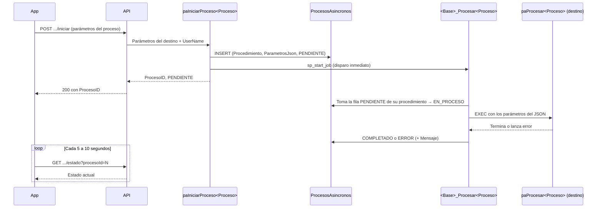

# Estándar: Procesos en segundo plano (cola + Job de SQL Server Agent)

Patrón para ejecutar procedimientos almacenados que tardan varios minutos sin que el API se quede esperando. El API **encola** la solicitud y responde de inmediato. Un **Job de SQL Server Agent** ejecuta el procedimiento aparte, y la app **consulta el estado** hasta que termina.

| | |
|---|---|
| **Versión** | 1.0.0 — 2026-10-26 |
| **Origen** | Proceso en segundo plano de Movimientos SAT (Conciliación SAT, DLB). Su documento, `conciliacion_sat/Proceso_Segundo_Plano_Movimientos_SAT.md`, no está en este repositorio. |
| **Capa** | SQL Server (tabla, procedimientos y Job) + API (.NET) |
| **Implementaciones** | 1) `paProcesarMovimientosSAT` (base `DLBENDICION`) |

> **Alcance.** Este documento explica el patrón de forma general, con plantillas para aplicarlo a cualquier procedimiento largo. Movimientos SAT aparece solo como ejemplo. El detalle de esa implementación está en su propio documento, fuera de este repositorio.

---

## Índice

1. [Cuándo usarlo](#1-cuándo-usarlo)
2. [Piezas del patrón](#2-piezas-del-patrón)
3. [Flujo y estados](#3-flujo-y-estados)
4. [Nomenclatura](#4-nomenclatura)
5. [Tabla `ProcesosAsincronos` (una sola vez por base)](#5-tabla-procesosasincronos-una-sola-vez-por-base)
6. [Procedimiento de inicio: `paIniciarProceso<Proceso>`](#6-procedimiento-de-inicio-painiciarprocesoproceso)
7. [Procedimiento de estado: `paObtenerEstadoProcesoAsincrono` (compartido)](#7-procedimiento-de-estado-paobtenerestadoprocesoasincrono-compartido)
8. [Job: `<Base>_Procesar<Proceso>`](#8-job-base_procesarproceso)
9. [Lado del API](#9-lado-del-api)
10. [Requisitos en el servidor](#10-requisitos-en-el-servidor)
11. [Casos especiales](#11-casos-especiales)
12. [Checklist para agregar un proceso nuevo](#12-checklist-para-agregar-un-proceso-nuevo)
13. [Mantenimiento del estándar](#13-mantenimiento-del-estándar)

---

## 1. Cuándo usarlo

| Usar el patrón | No usarlo |
|---|---|
| El procedimiento tarda más de lo que aguanta una petición HTTP y da *timeout*. | El procedimiento responde en segundos. |
| El usuario no necesita el resultado en la misma pantalla, solo saber si terminó. | La pantalla necesita los datos del resultado de inmediato (reportes, consultas). |
| Dos ejecuciones al mismo tiempo, por ejemplo de la misma empresa, se pisarían. | — |

---

## 2. Piezas del patrón

| # | Pieza | ¿Compartida o por proceso? | Qué hace |
|---|---|---|---|
| 1 | Tabla `ProcesosAsincronos` | **Compartida**: una por base | Cola de solicitudes. Cada fila es una ejecución pedida. |
| 2 | `paIniciarProceso<Proceso>` | **Por proceso** | Recibe los parámetros del procedimiento que se va a ejecutar, los guarda en la cola y **dispara el Job**. No ejecuta el procedimiento. |
| 3 | `paObtenerEstadoProcesoAsincrono` | **Compartido** | Devuelve el estado de una solicitud por `ProcesoID`. |
| 4 | Job `<Base>_Procesar<Proceso>` | **Por proceso** | Toma la solicitud pendiente, ejecuta el procedimiento destino con sus parámetros y registra el resultado. |
| 5 | `paProcesar<Proceso>` | Ya existe | El procedimiento largo que se quiere ejecutar en segundo plano. **No se modifica.** |
| 6 | Endpoints del API | `iniciar` por proceso; `estado` compartido | La app pide el proceso y consulta su avance. |

> **La idea clave.** `paIniciarProceso<Proceso>` es la **puerta de entrada al Job**. Tiene los mismos parámetros que el procedimiento destino (más `@UserName`), porque su trabajo es guardarlos para que el Job los use después. Por cada procedimiento largo nuevo se crea **su propio** procedimiento de inicio y **su propio** Job; la tabla y la consulta de estado se reutilizan.

---

## 3. Flujo y estados



```
PENDIENTE ──► EN_PROCESO ──► COMPLETADO
                   │
                   └────────► ERROR (con Mensaje)
```

| Estado | Quién lo pone | Significado |
|---|---|---|
| `PENDIENTE` | `paIniciarProceso<Proceso>` | Encolado, todavía no empieza. |
| `EN_PROCESO` | Job | Se está ejecutando. |
| `COMPLETADO` | Job | Terminó bien. |
| `ERROR` | Job | Falló. El motivo está en `Mensaje` y en `tbl_Error`. |

---

## 4. Nomenclatura

| Pieza | Formato | Ejemplo (Movimientos SAT) |
|---|---|---|
| Procedimiento destino | `paProcesar<Proceso>` | `paProcesarMovimientosSAT` |
| Procedimiento de inicio | `paIniciarProceso<Proceso>` | `paIniciarProcesoMovimientosSAT` |
| Job | `<Base>_Procesar<Proceso>` | `DLBENDICION_ProcesarMovimientosSAT` |
| Paso del Job | `Procesar pendiente` | `Procesar pendiente` |
| Horario del Job | `Respaldo cada 5 min` | `Respaldo cada 5 min` |
| Endpoint de inicio | `<recurso>/iniciar` | `movimientos-sat-kardex/iniciar` |
| Endpoint de estado | `<recurso>/estado` | `movimientos-sat-kardex/estado` |
| Errores de validación | Un rango de 100 números por proceso | `52001`–`52099` |

`<Proceso>` es el nombre corto del proceso (en el ejemplo, `MovimientosSAT`) y se repite igual en todas las piezas. Si el procedimiento destino ya existe con un nombre que no sigue el formato `paProcesar<Proceso>`, se conserva su nombre real donde las plantillas dicen `paProcesar<Proceso>`; no se renombra.

El nombre del Job lleva la base al inicio porque los Jobs viven en `msdb`, que es una sola por servidor. Así no chocan si el mismo proceso se instala en dos bases del mismo servidor.

---

## 5. Tabla `ProcesosAsincronos` (una sola vez por base)

Se crea **una vez** por base y la comparten todos los procesos. Si ya existe, se salta este paso.

> **Dónde existe hoy.** Actualmente la tabla `ProcesosAsincronos` solo está creada en la base de datos **`DLBENDICION`**. Para usar el patrón en cualquier otra base, primero hay que crearla ahí, junto con `paObtenerEstadoProcesoAsincrono` (sección 7).

| Columna | Tipo | Descripción |
|---|---|---|
| `ProcesoID` | `INT IDENTITY` (PK) | Identificador con el que se consulta el estado. |
| `Procedimiento` | `VARCHAR(100)` | Nombre del procedimiento destino. Con él, cada Job sabe qué filas le tocan. |
| `ParametrosJson` | `NVARCHAR(MAX)` | Parámetros del procedimiento destino, en JSON. |
| `Estado` | `VARCHAR(20)` | `PENDIENTE` (default), `EN_PROCESO`, `COMPLETADO`, `ERROR`. |
| `FechaSolicitud` | `DATETIME2` | Cuándo se encoló. Define el orden FIFO. |
| `FechaInicio` | `DATETIME2` | Cuándo empezó a ejecutarse. |
| `FechaFin` | `DATETIME2` | Cuándo terminó, con éxito o con error. |
| `RegistrosProcesados` | `INT` | Reservado para uso futuro. |
| `Mensaje` | `NVARCHAR(MAX)` | Mensaje de error cuando `Estado = 'ERROR'`. |
| `UserName` | `VARCHAR(30)` | Usuario que solicitó la ejecución. |

Los parámetros van en JSON para que cualquier procedimiento quepa en la misma tabla, sin agregar columnas por proceso.

```sql
USE [<Base>];
GO
SET ANSI_NULLS ON;
GO
SET QUOTED_IDENTIFIER ON;
GO

IF NOT EXISTS (SELECT 1 FROM sys.tables WHERE name = 'ProcesosAsincronos')
BEGIN
    CREATE TABLE dbo.ProcesosAsincronos (
         ProcesoID           INT IDENTITY(1,1) PRIMARY KEY  -- identificador con el que se consulta el estado
        ,Procedimiento       VARCHAR(100)   NOT NULL   -- procedimiento destino a ejecutar
        ,ParametrosJson      NVARCHAR(MAX)  NOT NULL   -- parametros del procedimiento destino en JSON
        ,Estado              VARCHAR(20)    NOT NULL DEFAULT 'PENDIENTE'  -- PENDIENTE / EN_PROCESO / COMPLETADO / ERROR
        ,FechaSolicitud      DATETIME2      NOT NULL DEFAULT SYSDATETIME()  -- fecha en que se encolo (orden FIFO)
        ,FechaInicio         DATETIME2      NULL  -- inicio de la ejecucion
        ,FechaFin            DATETIME2      NULL  -- fin de la ejecucion, con exito o con error
        ,RegistrosProcesados INT            NULL  -- reservado para uso futuro
        ,Mensaje             NVARCHAR(MAX)  NULL  -- mensaje de error cuando Estado='ERROR'
        ,UserName            VARCHAR(30)    NOT NULL  -- usuario que solicito la ejecucion
    );

    CREATE INDEX IX_ProcesosAsincronos_Estado_FechaSolicitud
        ON dbo.ProcesosAsincronos (Estado, FechaSolicitud);
END
GO
GRANT SELECT, INSERT, UPDATE, DELETE ON [dbo].[ProcesosAsincronos] TO [usuario];
GO
```

---

## 6. Procedimiento de inicio: `paIniciarProceso<Proceso>`

Es la pieza que cambia en cada proceso. **No ejecuta el procedimiento destino**; hace cuatro cosas:

1. **Recibe los parámetros del procedimiento destino**, con los mismos nombres, tipos y defaults, más `@UserName`.
2. **Valida** los obligatorios y que no haya otra solicitud `PENDIENTE` o `EN_PROCESO` que choque con esta, por ejemplo de la misma empresa.
3. **Encola**: guarda el nombre del procedimiento destino y sus parámetros en JSON en `ProcesosAsincronos`.
4. **Dispara el Job** con `sp_start_job`. Si no se puede disparar (falta de permisos o Job ocupado), **no devuelve error**: la fila queda `PENDIENTE` y la toma el horario de respaldo.

Devuelve `ProcesoID` y `Estado = 'PENDIENTE'`.

### Relación entre los parámetros

| Procedimiento destino | `paIniciarProceso<Proceso>` | JSON guardado | Paso del Job |
|---|---|---|---|
| `@Empresa INT` | `@Empresa INT` | `"Empresa": 1` | `JSON_VALUE(ParametrosJson,'$.Empresa')` → `@Empresa` |
| `@SoloSimular BIT = 0` | `@SoloSimular BIT = 0` | `"SoloSimular": false` | `JSON_VALUE(...,'$.SoloSimular')` → `@SoloSimular` |
| `@FechaDesde DATETIME = '260101'` | `@FechaDesde DATETIME = '260101'` | `"FechaDesde": "2026-01-01T00:00:00"` | `JSON_VALUE(...,'$.FechaDesde')` → `@FechaDesde` |
| — | `@UserName VARCHAR(30)` | Columna `UserName` | Para `tbl_Error` |

*(Ejemplo con `paProcesarMovimientosSAT`.)* Si el procedimiento destino cambia sus parámetros, hay que cambiar también `paIniciarProceso<Proceso>` y el paso del Job.

### Plantilla

Reemplazar todo lo que está entre `< >`.

```sql
USE [<Base>];
GO
SET ANSI_NULLS ON;
GO
SET QUOTED_IDENTIFIER ON;
GO

/* =============================================================================
   paIniciarProceso<Proceso>
   Encola una ejecucion de paProcesar<Proceso> y dispara el Job <Base>_Procesar<Proceso>.
   Recibe los mismos parametros que paProcesar<Proceso> (mas @UserName).
   ============================================================================= */
CREATE OR ALTER PROCEDURE dbo.paIniciarProceso<Proceso>
(
     -- Parametros de paProcesar<Proceso>: mismos nombres, tipos y defaults.
     @<Param1>   <TIPO>
    ,@<Param2>   <TIPO> = <DEFAULT>
     -- Usuario que solicita la ejecucion.
    ,@UserName   VARCHAR(30)
)
AS
BEGIN
    SET NOCOUNT ON;
    BEGIN TRY

        -- 1. Validaciones (rango de errores propio del proceso: <N>01 a <N>99).
        IF @<Param1> IS NULL
            THROW <N>01, 'paIniciarProceso<Proceso>: Debe enviar <Param1>.', 1;
        IF @UserName IS NULL OR LTRIM(RTRIM(@UserName)) = ''
            THROW <N>02, 'paIniciarProceso<Proceso>: Debe enviar UserName.', 1;

        -- 2. No se permite otra solicitud que choque con esta mientras siga pendiente o en curso.
        --    <ClaveUnica> es el parametro que no se puede repetir (por ejemplo, Empresa).
        IF EXISTS (
            SELECT 1 FROM dbo.ProcesosAsincronos
            WHERE Procedimiento = 'paProcesar<Proceso>'
              AND Estado IN ('PENDIENTE', 'EN_PROCESO')
              AND JSON_VALUE(ParametrosJson, '$.<ClaveUnica>') = CAST(@<ClaveUnica> AS VARCHAR(50))
        )
        BEGIN
            DECLARE @MensajeDuplicado NVARCHAR(300) =
                'paIniciarProceso<Proceso>: Ya hay un proceso pendiente o en curso para <ClaveUnica> '
                + CAST(@<ClaveUnica> AS VARCHAR(50)) + '. Consulte su estado antes de encolar otro.';
            THROW <N>03, @MensajeDuplicado, 1;
        END

        -- 3. Encolar: los parametros de paProcesar<Proceso> se guardan en JSON.
        DECLARE @ParametrosJson NVARCHAR(MAX) = (
            SELECT @<Param1> AS <Param1>, @<Param2> AS <Param2>
            FOR JSON PATH, WITHOUT_ARRAY_WRAPPER, INCLUDE_NULL_VALUES
        );

        INSERT INTO dbo.ProcesosAsincronos (Procedimiento, ParametrosJson, UserName)
        VALUES ('paProcesar<Proceso>', @ParametrosJson, @UserName);

        DECLARE @ProcesoID INT = SCOPE_IDENTITY();

        -- 4. Disparo inmediato del Job. Si falla, la fila queda PENDIENTE y la toma
        --    el horario de respaldo; por eso el error no se propaga.
        BEGIN TRY
            EXEC msdb.dbo.sp_start_job @job_name = '<Base>_Procesar<Proceso>';
        END TRY
        BEGIN CATCH
            DECLARE @ErrNumJob INT            = ERROR_NUMBER();
            DECLARE @ErrMsgJob NVARCHAR(4000) = ERROR_MESSAGE();

            BEGIN TRY
                INSERT INTO dbo.tbl_Error (Descripcion, Error_No, Fecha_Hora, Usuario)
                VALUES ('paIniciarProceso<Proceso>, disparo del Job (error SQL ' + CAST(@ErrNumJob AS VARCHAR(10)) + '): ' + @ErrMsgJob,
                        1, GETDATE(), @UserName);
            END TRY
            BEGIN CATCH
            END CATCH
        END CATCH

        SELECT @ProcesoID AS ProcesoID, 'PENDIENTE' AS Estado;

    END TRY
    BEGIN CATCH
        DECLARE @ErrNum INT            = ERROR_NUMBER();
        DECLARE @ErrMsg NVARCHAR(4000) = ERROR_MESSAGE();

        -- Las validaciones del proceso no se registran: son respuestas esperadas al usuario.
        IF @ErrNum NOT BETWEEN <N>01 AND <N>99
        BEGIN
            BEGIN TRY
                INSERT INTO dbo.tbl_Error (Descripcion, Error_No, Fecha_Hora, Usuario)
                VALUES ('paIniciarProceso<Proceso> (error SQL ' + CAST(@ErrNum AS VARCHAR(10)) + '): ' + @ErrMsg,
                        1, GETDATE(), @UserName);
            END TRY
            BEGIN CATCH
            END CATCH
        END;

        THROW;
    END CATCH
END
GO
GRANT EXEC ON [dbo].[paIniciarProceso<Proceso>] TO [usuario];
GO
```

> `INCLUDE_NULL_VALUES` guarda en el JSON los parámetros que llegan en `NULL`. Sin esa opción, la propiedad no aparece en el JSON y `JSON_VALUE` también devuelve `NULL`, así que el resultado es el mismo. Se incluye para que la fila muestre todos los parámetros al revisarla.

---

## 7. Procedimiento de estado: `paObtenerEstadoProcesoAsincrono` (compartido)

Es igual para todos los procesos: consulta la tabla por `ProcesoID`. Se crea una sola vez por base, junto con la tabla.

- Con `@ProcesoID`: devuelve esa solicitud.
- Sin `@ProcesoID`: devuelve las últimas 20 solicitudes de cualquier proceso.

```sql
CREATE OR ALTER PROCEDURE dbo.paObtenerEstadoProcesoAsincrono
(
    @ProcesoID INT = NULL
)
AS
BEGIN
    SET NOCOUNT ON;
    BEGIN TRY

        IF @ProcesoID IS NOT NULL
        BEGIN
            SELECT ProcesoID, Procedimiento, ParametrosJson, Estado, FechaSolicitud,
                   FechaInicio, FechaFin, RegistrosProcesados, Mensaje, UserName
            FROM dbo.ProcesosAsincronos
            WHERE ProcesoID = @ProcesoID;
        END
        ELSE
        BEGIN
            SELECT TOP 20 ProcesoID, Procedimiento, ParametrosJson, Estado, FechaSolicitud,
                   FechaInicio, FechaFin, RegistrosProcesados, Mensaje, UserName
            FROM dbo.ProcesosAsincronos
            ORDER BY FechaSolicitud DESC;
        END

    END TRY
    BEGIN CATCH
        DECLARE @ErrNum INT            = ERROR_NUMBER();
        DECLARE @ErrMsg NVARCHAR(4000) = ERROR_MESSAGE();

        BEGIN TRY
            INSERT INTO dbo.tbl_Error (Descripcion, Error_No, Fecha_Hora, Usuario)
            VALUES ('paObtenerEstadoProcesoAsincrono (error SQL ' + CAST(@ErrNum AS VARCHAR(10)) + '): ' + @ErrMsg,
                    1, GETDATE(), NULL);
        END TRY
        BEGIN CATCH
        END CATCH;

        THROW;
    END CATCH
END
GO
GRANT EXEC ON [dbo].[paObtenerEstadoProcesoAsincrono] TO [usuario];
GO
```

---

## 8. Job: `<Base>_Procesar<Proceso>`

Cada proceso tiene su propio Job. Cada ejecución:

1. Busca la solicitud `PENDIENTE` más antigua **de su procedimiento** (`WHERE Procedimiento = 'paProcesar<Proceso>'`), con `WITH (UPDLOCK, READPAST)` para que dos ejecuciones nunca tomen la misma fila.
2. La pasa a `EN_PROCESO`.
3. Lee cada parámetro del JSON con `JSON_VALUE` y ejecuta el procedimiento destino.
4. Si termina bien, la deja `COMPLETADO`. Si falla, hace `ROLLBACK` si quedó una transacción abierta, la deja en `ERROR` con el mensaje y lo registra en `tbl_Error`.
5. Si no hay pendientes de su procedimiento, termina sin hacer nada.

> **Filtrar por `Procedimiento` es obligatorio cuando hay más de un proceso en la base.** Sin el filtro, un Job podría tomar como «la más antigua» una solicitud de otro proceso, ignorarla y dejarla `PENDIENTE` para siempre. El Job actual de Movimientos SAT no filtra en el `SELECT` (lo valida después con un `IF`), lo cual funciona mientras sea el único proceso de la base. Al agregar el segundo, hay que añadirle el filtro.

| Configuración | Valor |
|---|---|
| Nombre | `<Base>_Procesar<Proceso>` |
| Paso | `Procesar pendiente` · T-SQL · base `<Base>` |
| Reintentos | 0 (el error queda registrado en la fila) |
| Al terminar bien / con error | Termina el Job reportando éxito / fallo |
| Horario | `Respaldo cada 5 min`: diario, cada 5 minutos |

El horario de 5 minutos es solo un **respaldo**: normalmente el Job arranca en segundos porque `paIniciarProceso<Proceso>` lo dispara. Cuando no hay pendientes, la revisión dura milisegundos. Si el Job ya está corriendo, el Agent no inicia otra ejecución encima.

### Plantilla del paso (comillas normales, para crearlo a mano en SSMS)

```sql
DECLARE @ProcesoID INT, @UserName VARCHAR(30), @ErrNum INT, @ErrMsg NVARCHAR(4000), @ParametrosJson NVARCHAR(MAX);
-- Variables de los parametros de paProcesar<Proceso>.
DECLARE @<Param1> <TIPO>, @<Param2> <TIPO>;

-- Solicitud pendiente mas antigua DE ESTE PROCEDIMIENTO.
SELECT TOP 1
     @ProcesoID      = ProcesoID
    ,@UserName       = UserName
    ,@ParametrosJson = ParametrosJson
FROM dbo.ProcesosAsincronos WITH (UPDLOCK, READPAST)
WHERE Estado = 'PENDIENTE'
  AND Procedimiento = 'paProcesar<Proceso>'
ORDER BY FechaSolicitud;

IF @ProcesoID IS NOT NULL
BEGIN
    UPDATE dbo.ProcesosAsincronos SET Estado='EN_PROCESO', FechaInicio=SYSDATETIME() WHERE ProcesoID=@ProcesoID;

    -- Parametros del JSON (un JSON_VALUE por parametro, con el tipo de paProcesar<Proceso>).
    SET @<Param1> = CAST(JSON_VALUE(@ParametrosJson,'$.<Param1>') AS <TIPO>);
    SET @<Param2> = CAST(JSON_VALUE(@ParametrosJson,'$.<Param2>') AS <TIPO>);

    BEGIN TRY
        EXEC dbo.paProcesar<Proceso> @<Param1>=@<Param1>, @<Param2>=@<Param2>;

        UPDATE dbo.ProcesosAsincronos SET Estado='COMPLETADO', FechaFin=SYSDATETIME() WHERE ProcesoID=@ProcesoID;
    END TRY
    BEGIN CATCH
        SET @ErrNum = ERROR_NUMBER();
        SET @ErrMsg = ERROR_MESSAGE();

        IF @@TRANCOUNT > 0               -- por si el proceso dejo una transaccion abierta
            ROLLBACK TRANSACTION;

        UPDATE dbo.ProcesosAsincronos SET Estado='ERROR', FechaFin=SYSDATETIME(), Mensaje=@ErrMsg WHERE ProcesoID=@ProcesoID;

        BEGIN TRY
            INSERT INTO dbo.tbl_Error (Descripcion, Error_No, Fecha_Hora, Usuario)
            VALUES ('<Base>_Procesar<Proceso>, ProcesoID ' + CAST(@ProcesoID AS VARCHAR(10))
                    + ' (error SQL ' + CAST(@ErrNum AS VARCHAR(10)) + '): ' + @ErrMsg,
                    1, GETDATE(), @UserName);
        END TRY
        BEGIN CATCH
        END CATCH
    END CATCH
END
```

### Plantilla de creación por script

Dentro de `@command` va el bloque de arriba, pero **con las comillas simples duplicadas** (`''`), porque está dentro de un texto. Se ejecuta con un login sysadmin y solo crea el Job si no existe.

```sql
USE [msdb];
GO

IF NOT EXISTS (SELECT 1 FROM msdb.dbo.sysjobs WHERE name = '<Base>_Procesar<Proceso>')
BEGIN
    DECLARE @JobId BINARY(16);

    BEGIN TRANSACTION;

    EXEC msdb.dbo.sp_add_job
        @job_name    = N'<Base>_Procesar<Proceso>',
        @description = N'Procesa la solicitud PENDIENTE mas antigua de paProcesar<Proceso> en ProcesosAsincronos. Disparado por paIniciarProceso<Proceso>, con un horario de respaldo cada 5 minutos.',
        @enabled     = 1,
        @job_id      = @JobId OUTPUT;

    EXEC msdb.dbo.sp_add_jobstep
        @job_id            = @JobId,
        @step_name         = N'Procesar pendiente',
        @subsystem         = N'TSQL',
        @database_name     = N'<Base>',
        @command           = N'<bloque del paso con las comillas duplicadas>',
        @retry_attempts    = 0,   -- sin reintentos: el error queda registrado en la fila
        @on_success_action = 1,   -- 1 = terminar el Job como exitoso
        @on_fail_action    = 2;   -- 2 = terminar el Job como fallido

    -- Horario de respaldo: todos los dias, cada 5 minutos.
    EXEC msdb.dbo.sp_add_jobschedule
        @job_id               = @JobId,
        @name                 = N'Respaldo cada 5 min',
        @enabled              = 1,
        @freq_type            = 4,   -- diario
        @freq_interval        = 1,
        @freq_subday_type     = 4,   -- minutos
        @freq_subday_interval = 5;

    EXEC msdb.dbo.sp_add_jobserver
        @job_id      = @JobId,
        @server_name = N'(local)';

    COMMIT TRANSACTION;
END
GO
```

---

## 9. Lado del API

Sigue el patrón del API:
- un controlador delgado llama a un servicio;
- el servicio hereda de `StoredProcedureExecutor`;
- la respuesta es un `ApiResponseModel<List<T>>`.

| Pieza | ¿Compartida o por proceso? |
|---|---|
| Modelo de solicitud `IniciarProceso<Proceso>M` | Por proceso: los mismos campos que los parámetros del procedimiento de inicio. |
| Método de servicio `paIniciarProceso<Proceso>` | Por proceso. |
| Endpoint `POST <recurso>/iniciar` | Por proceso. |
| Modelo de respuesta `IniciarProcesoAsincronoResponseM` (`ProcesoID`, `Estado`) | **Compartido.** |
| Modelo `ProcesoAsincronoM` (fila de la tabla) | **Compartido.** |
| Método de servicio `paObtenerEstadoProcesoAsincrono` | **Compartido.** |
| Endpoint `GET <recurso>/estado` | Compartido en lógica. Cada módulo puede exponerlo en su propia ruta. |

### Modelo de solicitud (por proceso)

```csharp
namespace ApiBusiness.Models.Request.<Modulo>
{
    //Parametros de paIniciarProceso<Proceso>: los mismos de paProcesar<Proceso> mas UserName.
    public class IniciarProceso<Proceso>M
    {
        public <Tipo> <Param1> { get; set; }

        //Opcional: si no se envia, el servicio manda el mismo default del procedimiento.
        public <Tipo>? <Param2> { get; set; }

        public string UserName { get; set; } = string.Empty;
    }
}
```

### Servicio (por proceso)

```csharp
public async Task<ApiResponseModel<List<IniciarProcesoAsincronoResponseM>>> paIniciarProceso<Proceso>(
    IniciarProceso<Proceso>M req
)
{
    string storeProcedure = "paIniciarProceso<Proceso>";

    var parameters = new SqlParameter[]
    {
        new("@<Param1>", SqlDbType.<Tipo>) { Value = req.<Param1> },
        //El default de un procedimiento solo aplica si el parametro se OMITE,
        //no si llega NULL: si es opcional, se manda el mismo default explicitamente.
        new("@<Param2>", SqlDbType.<Tipo>) { Value = req.<Param2> ?? <DEFAULT> },
        new("@UserName", SqlDbType.VarChar, 30) { Value = req.UserName }
    };

    return await ExecuteStoredProcedureAsync(storeProcedure, IniciarProcesoAsincronoResponseM.MapToModel, parameters);
}
```

### Servicio de estado (compartido)

```csharp
public async Task<ApiResponseModel<List<ProcesoAsincronoM>>> paObtenerEstadoProcesoAsincrono(
    int? procesoId
)
{
    string storeProcedure = "paObtenerEstadoProcesoAsincrono";

    var parameters = new SqlParameter[]
    {
        new("@ProcesoID", SqlDbType.Int) { Value = procesoId ?? (object)DBNull.Value }
    };

    return await ExecuteStoredProcedureAsync(storeProcedure, ProcesoAsincronoM.MapToModel, parameters);
}
```

### Controlador

```csharp
[Authorize]
[HttpPost("<recurso>/iniciar")]
public async Task<ActionResult> IniciarProceso<Proceso>(
    [FromBody] IniciarProceso<Proceso>M request
)
{
    ApiResponseModel<List<IniciarProcesoAsincronoResponseM>> response =
        await _service.paIniciarProceso<Proceso>(request);

    if (response.Status)
        return Ok(response);

    return BadRequest(response);
}

[Authorize]
[HttpGet("<recurso>/estado")]
public async Task<ActionResult> EstadoProceso<Proceso>(
    [FromQuery] int? procesoId
)
{
    ApiResponseModel<List<ProcesoAsincronoM>> response =
        await _service.paObtenerEstadoProcesoAsincrono(procesoId);

    if (response.Status)
        return Ok(response);

    return BadRequest(response);
}
```

### Modelos compartidos

```csharp
//Respuesta de cualquier paIniciarProceso<Proceso>: ProcesoID y estado inicial.
public class IniciarProcesoAsincronoResponseM
{
    public int ProcesoID { get; set; }
    public string? Estado { get; set; }

    public static IniciarProcesoAsincronoResponseM MapToModel(SqlDataReader reader)
    {
        return new IniciarProcesoAsincronoResponseM()
        {
            ProcesoID = reader.GetBulkValue<int>("ProcesoID"),
            Estado = reader.GetBulkValue<string?>("Estado")
        };
    }
}

//Una fila de ProcesosAsincronos. FechaInicio/FechaFin/Mensaje llegan null
//mientras la solicitud sigue PENDIENTE o EN_PROCESO.
public class ProcesoAsincronoM
{
    public int ProcesoID { get; set; }
    public string? Procedimiento { get; set; }
    public string? ParametrosJson { get; set; }
    public string? Estado { get; set; }
    public DateTime? FechaSolicitud { get; set; }
    public DateTime? FechaInicio { get; set; }
    public DateTime? FechaFin { get; set; }
    public int? RegistrosProcesados { get; set; }
    public string? Mensaje { get; set; }
    public string? UserName { get; set; }

    public static ProcesoAsincronoM MapToModel(SqlDataReader reader)
    {
        return new ProcesoAsincronoM()
        {
            ProcesoID = reader.GetBulkValue<int>("ProcesoID"),
            Procedimiento = reader.GetBulkValue<string?>("Procedimiento"),
            ParametrosJson = reader.GetBulkValue<string?>("ParametrosJson"),
            Estado = reader.GetBulkValue<string?>("Estado"),
            FechaSolicitud = reader.GetBulkValue<DateTime?>("FechaSolicitud"),
            FechaInicio = reader.GetBulkValue<DateTime?>("FechaInicio"),
            FechaFin = reader.GetBulkValue<DateTime?>("FechaFin"),
            RegistrosProcesados = reader.GetBulkValue<int?>("RegistrosProcesados"),
            Mensaje = reader.GetBulkValue<string?>("Mensaje"),
            UserName = reader.GetBulkValue<string?>("UserName")
        };
    }
}
```

### Errores y uso desde la app

Si un procedimiento lanza un error, el API responde **400** con `status: false`, el mensaje en `error` y `errorCode = "1-<número SQL>"`. Por ejemplo, `1-<N>03` significa que ya hay una solicitud en curso.

La app:
1. Llama a `iniciar` y guarda el `procesoID`.
2. Consulta `estado?procesoId=N` cada 5 a 10 segundos.
3. Deja de consultar cuando llega `COMPLETADO` o `ERROR`. Si es `ERROR`, muestra `mensaje`.

---

## 10. Requisitos en el servidor

| Requisito | Por qué | Cómo revisarlo |
|---|---|---|
| SQL Server Agent **Running** y en **Automatic** | Si está detenido, ninguna solicitud se ejecuta y queda bloqueada la siguiente con el error de duplicado. | `SELECT * FROM sys.dm_server_services` |
| Login del API con `SQLAgentOperatorRole` en `msdb` (o sysadmin) | Necesario para el disparo inmediato. Sin él, todo espera al horario de 5 minutos. | `USE msdb; SELECT IS_ROLEMEMBER('SQLAgentOperatorRole', '<LoginApi>')` |
| Login sysadmin para crear el Job | `sp_add_job` lo exige. | `SELECT IS_SRVROLEMEMBER('sysadmin')` |

Permiso para el login del API (se da una sola vez por servidor, sirve para todos los procesos):

```sql
USE [msdb];

IF NOT EXISTS (SELECT 1 FROM sys.database_principals WHERE name = N'<LoginApi>')
    CREATE USER [<LoginApi>] FOR LOGIN [<LoginApi>];

IF IS_ROLEMEMBER('SQLAgentOperatorRole', '<LoginApi>') = 0
    ALTER ROLE SQLAgentOperatorRole ADD MEMBER [<LoginApi>];
```

`ALTER ROLE ... ADD MEMBER` **agrega** el rol y no quita los que el usuario ya tenga.

---

## 11. Casos especiales

| Caso | Qué pasa | Qué hacer |
|---|---|---|
| El Agent está detenido | Las solicitudes quedan `PENDIENTE` y no se puede encolar otra con la misma clave. | Encender el Agent: las pendientes se ejecutan solas. |
| Dos solicitudes del mismo proceso con distinta clave | La segunda espera a que termine la primera y la toma el horario de respaldo, como máximo 5 minutos después. | Nada. |
| Se detiene el Job o se reinicia el servidor a mitad del proceso | La fila queda en `EN_PROCESO` para siempre y bloquea esa clave. | Pasarla a `ERROR` a mano (abajo). |
| El procedimiento destino falla | Queda `ERROR` con el mensaje en la fila y en `tbl_Error`. | Revisar el mensaje, corregir y volver a solicitar. |
| Se cambian los parámetros del procedimiento destino | El Job ejecuta con los parámetros viejos o falla. | Actualizar `paIniciarProceso<Proceso>`, el paso del Job y el modelo del API. |

Para liberar una solicitud interrumpida:

```sql
UPDATE dbo.ProcesosAsincronos
SET Estado = 'ERROR', FechaFin = SYSDATETIME(),
    Mensaje = 'Cancelado manualmente: el proceso se interrumpio.'
WHERE ProcesoID = <ProcesoID> AND Estado IN ('PENDIENTE', 'EN_PROCESO');
```

Consultas útiles:

```sql
-- Solicitudes sin terminar, de todos los procesos
SELECT * FROM dbo.ProcesosAsincronos WHERE Estado IN ('PENDIENTE', 'EN_PROCESO');

-- Historial de ejecuciones de un Job
SELECT TOP 20 h.run_date, h.run_time, h.run_duration, h.run_status, h.message
FROM msdb.dbo.sysjobhistory h
JOIN msdb.dbo.sysjobs j ON j.job_id = h.job_id
WHERE j.name = '<Base>_Procesar<Proceso>' AND h.step_id = 0
ORDER BY h.instance_id DESC;
```

---

## 12. Checklist para agregar un proceso nuevo

| # | Paso | Hecho |
|---|---|---|
| 1 | Confirmar que el procedimiento destino `paProcesar<Proceso>` realmente necesita segundo plano (sección 1). | ☐ |
| 2 | Verificar que existan `ProcesosAsincronos` y `paObtenerEstadoProcesoAsincrono` en la base; si no, crearlos (secciones 5 y 7). | ☐ |
| 3 | Elegir la clave que no se puede repetir (por ejemplo, empresa) y el rango de errores del proceso. | ☐ |
| 4 | Crear `paIniciarProceso<Proceso>` con los mismos parámetros que `paProcesar<Proceso>` (sección 6). | ☐ |
| 5 | Crear el Job `<Base>_Procesar<Proceso>`, con el filtro por `Procedimiento` en el `SELECT` (sección 8). | ☐ |
| 6 | Si en la base ya había otro proceso cuyo Job no filtra por `Procedimiento`, agregarle el filtro. | ☐ |
| 7 | Verificar el Agent encendido y el permiso del login del API (sección 10). | ☐ |
| 8 | API: modelo de solicitud, método de servicio y endpoint `iniciar`; reutilizar `estado` (sección 9). | ☐ |
| 9 | Probar: encolar, ver `PENDIENTE` → `EN_PROCESO` → `COMPLETADO`; intentar encolar otro con la misma clave y ver el error de duplicado; forzar un error y verlo en `Mensaje` y `tbl_Error`. | ☐ |
| 10 | Documentar la implementación concreta y agregarla al estándar. | ☐ |

---

## 13. Mantenimiento del estándar

- **Versionado** [SemVer](https://semver.org/lang/es/): MAJOR = cambia el contrato (columnas o estados de `ProcesosAsincronos`, nombres de las piezas, parámetros o forma de los endpoints), MINOR = agrega piezas u opciones compatibles, PATCH = corrige sin cambiar el contrato.
- Todo cambio se aplica a las plantillas de SQL y del API en el mismo commit.
- Cada proceso nuevo que use el patrón se agrega a **Implementaciones** en la tabla del inicio (paso 10 del [checklist](#12-checklist-para-agregar-un-proceso-nuevo)).
- Cada equipo, al copiar una plantilla, anota en un comentario la versión del estándar usada (`-- Estandar procesos segundo plano v1.0.0`).

### Historial

| Versión | Fecha | Cambios |
|---|---|---|
| 1.0.0 | 2026-10-26 | Primera versión. Patrón general (tabla `ProcesosAsincronos`, procedimientos de inicio y de estado, Job y lado del API), tomado del proceso de Movimientos SAT. |
